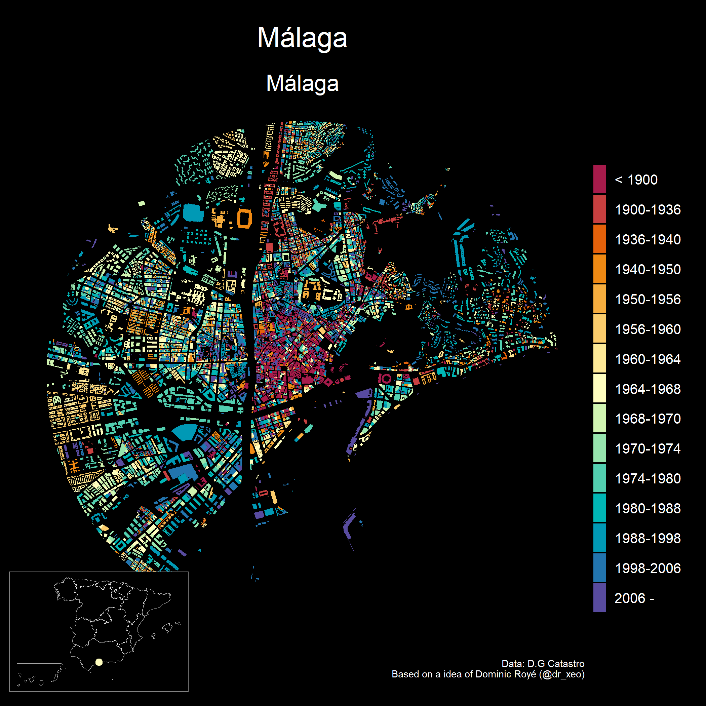
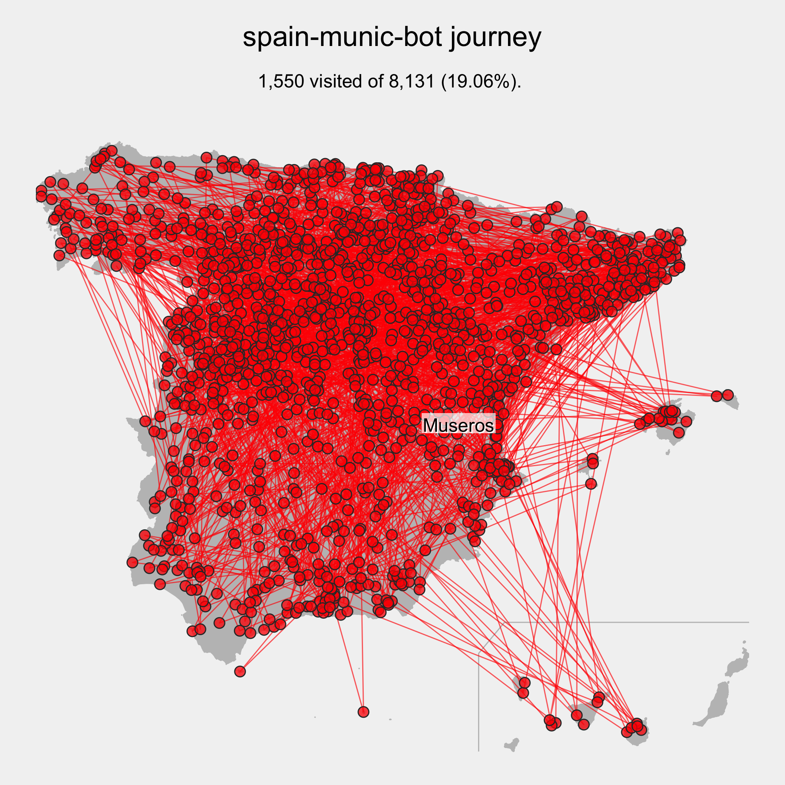

# spain-munic-bot :es::robot:

## A Twitter bot written in R

The bot generated a map of a Spanish town together with its name, province and
autonomous community (and an inset map of Spain showing the region and the
community). The bot was configured to publish every 20 minutes. Automated posting is
currently disabled. The last public output record is dated May 17, 2022.

## [Project website](https://dieghernan.github.io/spain-munic-bot/)

## Buildings

The project maps the urban growth of Spanish cities, based on the works of
**Dominic Royé:** [Visualize urban
growth](https://dominicroye.github.io/en/2019/visualize-urban-growth/)

Browse the [generated-map records](https://github.com/dieghernan/spain-munic-bot/blob/main/assets/datalog.csv).

## Project journey

## R packages

Core packages used in the project are:

-   [**CatastRo**](https://ropenspain.github.io/CatastRo/) for the buildings.
-   [**mapSpain**](https://ropenspain.github.io/mapSpain/) for the location of the
    municipalities.
-   [**ggplot2**](https://ggplot2.tidyverse.org/) for plotting.
-   [**rtweet**](https://docs.ropensci.org/rtweet/) for posting.

Other packages include **sf**, **dplyr** and supporting tools.

The project uses **renv** to record its R package dependencies. External data
services and publishing APIs may have changed since the maps were generated.

## Credits

-   Based on

    -   [italiancomuni](https://twitter.com/italiancomuni), by \@espinielli.

-   Automation:

    -   GitHub Actions as per \@espinielli's [GitHub
        Repo](https://github.com/espinielli/italian-comuni-bot).

-   Sources:

    -   [mapSpain](https://ropenspain.github.io/mapSpain/) R package.
    -   [osmdata](https://docs.ropensci.org/osmdata/) for the streets.

## Original execution workflow

The original entry point is shown below. It invokes the map-generation and
Twitter publishing code. Review its configuration, dependencies and API
credentials before running it; it is not a preview-only command.

        $ Rscript R/trigger.R

This will trigger `R/01_create_map.R` and compose the tweet.
